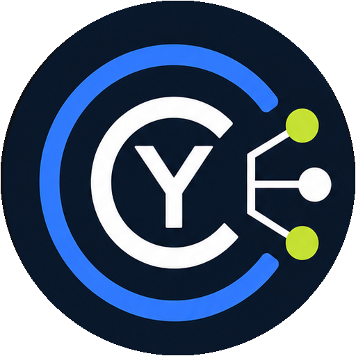
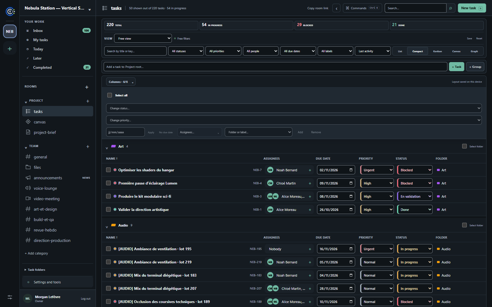
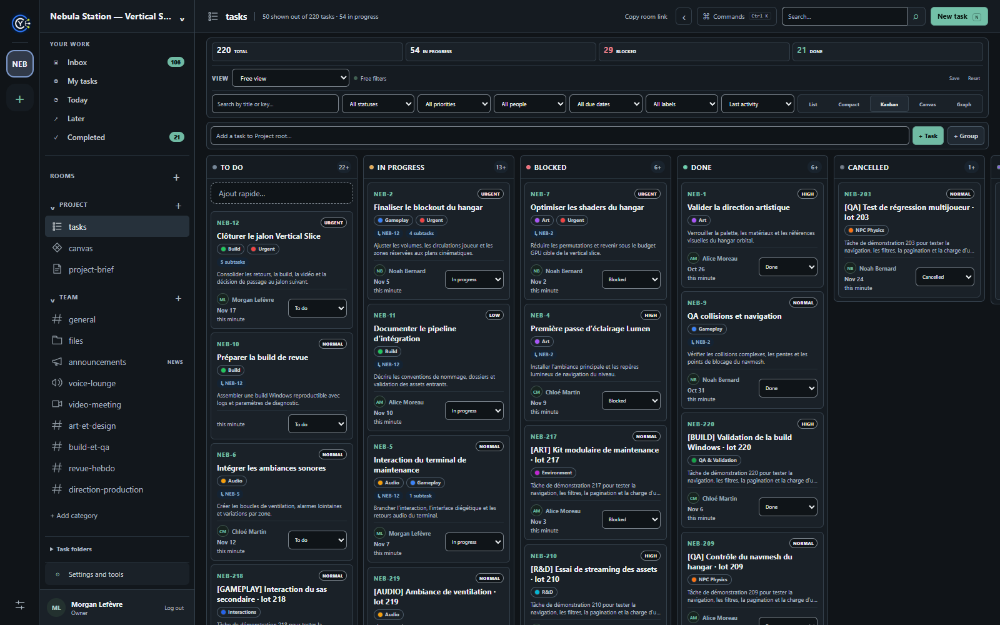
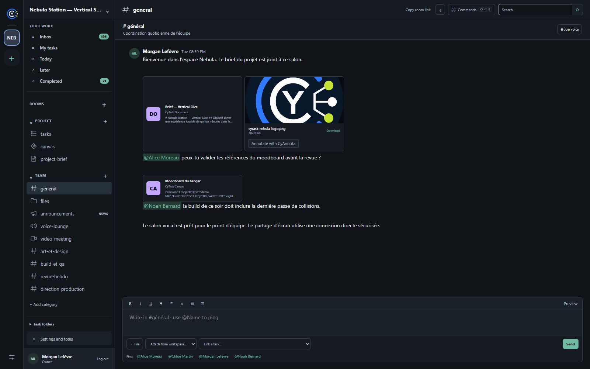
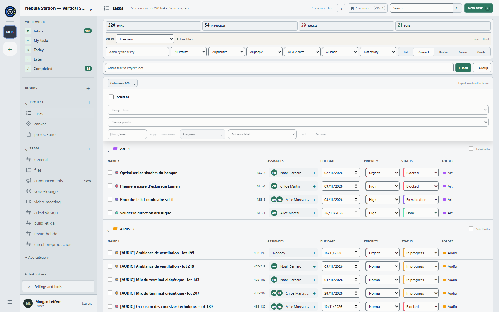

<table width="100%">
  <tr>
    <td width="300" align="left" valign="top">
      <a href="https://mrmybal.github.io/CyTask/Documentation.html#/fr/getting-started">Documentation</a><br>
      <a href="https://github.com/MrMybal/CyTask">Dépôt des sources</a><br>
      <a href="https://github.com/MrMybal/CyTask/issues">Suivi des problèmes</a><br><br>
      <sub>README</sub><br>
      <a href="README.md">English</a> · <a href="README.fr.md">Français</a>
    </td>
    <td width="400" align="center" valign="middle">
      <a href="assets/branding/cytask-logo.png"></a>
    </td>
    <td width="300" align="right" valign="top">
      <p><sub>Licence de l’application</sub><br><a href="LICENSE"><strong>GNU AGPL v3</strong></a></p>
      <p><sub>Version</sub><br><a href="CHANGELOG.fr.md"><strong>0.2.3</strong></a><br><strong>EN DÉVELOPPEMENT</strong></p>
      <p><a href="https://github.com/MrMybal/CyTask/releases/tag/v0.2.3"><strong>Télécharger la 0.2.3</strong></a><br><sub>Windows x64 · portable / installateur</sub></p>
    </td>
  </tr>
</table>

<h1 align="center">CyTask</h1>

Un gestionnaire de projets et de tâches open source pour les équipes de production numérique, les créateurs indépendants et les projets Unreal Engine. Utilisez un dossier local en solo, synchronisez des appareils de confiance ou connectez-vous à votre serveur d’équipe auto-hébergé. Un dépôt Git reste facultatif.

> **EN DÉVELOPPEMENT · 0.2.3**
>
> Un client Windows est disponible pour les essais et retours. Certaines intégrations et plateformes restent incomplètes ; conservez des sauvegardes restaurables des projets importants. Consultez les [notes de version et limites documentées](CHANGELOG.fr.md).

[](assets/screenshots/tasks-compact.png)

## À propos de CyTask

Les projets sont des espaces avec catégories et salons typés : tableaux de tâches, discussions d’équipe, annonces, documents, canvas, fichiers et appels en direct. Classez les tâches dans des dossiers et sous-dossiers, assignez plusieurs personnes, définissez des états colorés et suivez sous-tâches, checklists et dépendances. Choisissez la vue Liste, Compacte, Kanban, Canvas ou Graphe selon le travail.

Le client desktop peut ouvrir directement un dossier local en mode solo, sans écran de création de compte. Le mode Sync transporte des snapshots immuables et des médias par un outil externe comme Syncthing ou CyRevision Sync ; il ne réplique pas une base active. Un serveur d’équipe utilise PostgreSQL, des invitations et des droits propres à chaque projet.

| Tableau Kanban | Discussion d’équipe et médias partagés |
| --- | --- |
| [](assets/screenshots/kanban.png) | [](assets/screenshots/team-chat.png) |

Ces captures présentent le projet fictif **Nebula Station** et ses 220 tâches. Les textes saisis dans le projet conservent leur langue d’origine. L’interface est en anglais par défaut et propose aussi le français.

<details>
<summary>Voir l’apparence claire</summary>

[](assets/screenshots/tasks-light.png)

Six préréglages sont disponibles : Graphite, Minuit, Forêt, Brume, Papier et Contraste élevé.

</details>

## Fonctionnalités

- **Tâches et hiérarchie** : responsables multiples, états personnalisés, priorités, dates, labels, tâches parentes/enfants, dépendances, checklists et historique d’activité.
- **Navigation rapide** : tri par colonne, modification directe, filtres enregistrés, colonnes configurables, opérations groupées, palette de commandes et liens partageables.
- **Salons d’équipe** : discussions et groupes privés, mentions, aperçus de tâches, lecture d’images/vidéos, vocal, caméras en direct et partage d’écran indépendant.
- **Ressources partagées** : documents, canvas multimédias, dessin, fichiers et pièces jointes, avec aperçus d’images sur les cartes Kanban.
- **Local ou hébergé** : dossiers autonomes, espaces synchronisés par un outil externe ou serveur auto-hébergé, avec double authentification et chiffrement au repos optionnels.
- **Migration** : aperçu des imports ClickUp ou Jira Cloud, correspondance des utilisateurs et états, puis import des données prises en charge sans dupliquer les imports précédents. Les pièces jointes distantes restent des liens vers la source.
- **Intégrations facultatives** : Git, AI Assistant, Unreal Engine, CyRevision et CyAnnota ; CyMD ajoute l’édition Markdown enrichie. Les plugins apportent des champs validés et actions de contenu prises en charge, pas du code arbitraire injecté par manifeste.
- **Agents et automatisation** : identités à droits limités, appels persistants, notifications, prise atomique des tâches, SDK JavaScript et connecteur MCP stdio. Un appel de travail n’exécute pas arbitrairement le texte d’une tâche.
- **Aide intégrée** : guides CyDoc complets en anglais/français, contrats API, captures, schémas SVG, recherche et thèmes de lecture. Le desktop ouvre directement `Documentation/Documentation.html` ; le même lecteur est [disponible en ligne](https://mrmybal.github.io/CyTask/Documentation.html#/fr/getting-started).

---

## Installation

### Windows x64

Le client 0.2.3 publié comprend Electron, le moteur .NET local, l’interface Web et l’aide hors ligne. Le mode local solo ne nécessite pas d’installation séparée de Node.js, du SDK .NET ou d’une base de données.

1. Téléchargez l’[exécutable portable](https://github.com/MrMybal/CyTask/releases/download/v0.2.3/CyTask-0.2.3-portable-x64.exe) ou l’[installateur](https://github.com/MrMybal/CyTask/releases/download/v0.2.3/CyTask-0.2.3-setup-x64.exe).
2. Fermez l’ancienne instance de CyTask, puis lancez la portable ou l’installateur. Conservez vos dossiers de projet et sauvegardez séparément les clés de chiffrement.
3. Choisissez **Dossier local** pour travailler seul, **Sync** pour un dossier synchronisé par un outil externe, ou une connexion serveur avec son adresse HTTPS et votre compte d’équipe.
4. Créez un projet et une première tâche, ou rouvrez un espace existant.

Les [notes de publication et empreintes SHA-256](https://github.com/MrMybal/CyTask/releases/tag/v0.2.3) accompagnent les téléchargements. Ces exécutables ne sont pas signés avec Authenticode ; Windows SmartScreen peut afficher un avertissement.

### Serveur d’équipe et autres plateformes

Déployez votre serveur avec un stockage persistant PostgreSQL/médias et HTTPS ; consultez le [manuel d’administration](https://mrmybal.github.io/CyTask/Documentation.html#/fr/administration) et la [configuration de déploiement](infra/README.md). SMTP et STUN/TURN se configurent séparément si les codes e-mail ou les appels en ont besoin.

Des cibles de packaging Linux et macOS existent dans les sources, mais la release 0.2.3 ne fournit que les binaires Windows x64. Aucun client Android n’est publié. Voir les [limites de plateforme et d’intégration](CHANGELOG.fr.md#limites-documentées).

## Sources, compilation et bibliothèques nécessaires

<details>
<summary>Compiler le client desktop ou lancer l’espace de développement</summary>

Utilisez Node.js **22.17.1** avec npm, le SDK .NET **10.0.302** indiqué dans `global.json` et PowerShell 7 pour les scripts Windows. PostgreSQL sert au déploiement d’équipe persistant, pas au moteur de dossier local. Unreal n’est nécessaire que pour compiler son plugin source facultatif.

```sh
git clone https://github.com/MrMybal/CyTask.git
cd CyTask
npm ci --prefix apps/web
npm ci --prefix apps/client
npm ci --prefix plugins/cymd/web
npm ci --prefix plugins/cyannota/web
npm run dist:win --prefix apps/client
```

La compilation desktop construit les deux éditeurs embarqués, l’interface Web et la documentation, publie le serveur autonome, puis écrit portable et installateur dans `apps/client/release/`. Elle installe l’archive CyDoc locale épinglée ; l’accès au dépôt source privé de CyDoc n’est pas nécessaire. Utilisez un `dotnet` système ou placez le SDK sous `.tools/dotnet`.

Pour le développement, le script Windows attend précisément `.tools/dotnet/dotnet.exe` :

```powershell
./scripts/dev.ps1
```

Ouvrez `http://127.0.0.1:5173`. Ce serveur de développement utilise un stockage mémoire et perd ses données au redémarrage ; ce n’est pas un déploiement d’équipe persistant. Pendant son exécution, lancez `pwsh ./scripts/seed-demo.ps1` dans un autre terminal pour créer l’espace fictif de 220 tâches. Les identifiants de démonstration ne doivent pas devenir des valeurs par défaut en production.

Voir la [compilation desktop](apps/client/README.fr.md), la [rédaction documentaire](.CyDocBuild/README.md), le [SDK](packages/sdk-js/README.md) et le [connecteur MCP](integrations/mcp/README.md). Les cibles Linux/macOS et le plugin Unreal nécessitent leurs propres compilations par plateforme/moteur ; consultez l’[intégration Unreal](integrations/unreal/README.md).

</details>

---

## Licence

Le fichier [LICENSE](LICENSE) à la racine de CyTask contient la **GNU Affero General Public License v3**. Les composants tiers conservent leurs propres conditions ; la licence MIT de CyDoc ou d’Electron ne change pas celle de CyTask.

### Principaux composants d’exécution et facultatifs

| Bibliothèque · sources | Licence · texte | Utilisation / périmètre |
| --- | --- | --- |
| [React / React DOM](https://github.com/facebook/react) | [MIT](https://github.com/facebook/react/blob/main/LICENSE) | Interfaces Web de l’application et des éditeurs embarqués. |
| [CodeMirror](https://github.com/codemirror) / [Lezer](https://github.com/lezer-parser) | [MIT](https://github.com/codemirror/view/blob/main/LICENSE) | Édition Markdown et infrastructure syntaxique. |
| [markdown-it](https://github.com/markdown-it/markdown-it) | [MIT](https://github.com/markdown-it/markdown-it/blob/master/LICENSE) | Rendu Markdown de l’application et de CyMD. |
| [highlight.js](https://github.com/highlightjs/highlight.js) | [BSD-3-Clause](https://github.com/highlightjs/highlight.js/blob/main/LICENSE) | Coloration du code dans les messages et documents. |
| [DOMPurify](https://github.com/cure53/DOMPurify) | [Apache-2.0](https://github.com/cure53/DOMPurify/blob/main/LICENSE) OU [MPL-2.0](https://github.com/cure53/DOMPurify/blob/main/LICENSE-MPL) | Nettoyage du contenu enrichi rendu ; choix de double licence conservé. |
| [node-qrcode](https://github.com/soldair/node-qrcode) | [MIT](https://github.com/soldair/node-qrcode/blob/master/license) | Génération locale des QR codes d’authentification. |
| [Electron 44.9.3](https://github.com/electron/electron) | [MIT](https://github.com/electron/electron/blob/v44.9.3/LICENSE) et notices des composants embarqués | Runtime desktop, dont les composants Chromium et Node.js. |
| [.NET / ASP.NET Core 10](https://github.com/dotnet/runtime) | [.NET Library License](https://dotnet.microsoft.com/en-us/dotnet_library_license.htm) pour les distributions Windows ; [MIT et conditions des composants](https://github.com/dotnet/core/blob/main/license-information.md) pour les sources/Linux/macOS | Serveur et moteur autonome du desktop. |
| [Npgsql 10.0.3](https://github.com/npgsql/npgsql) / [PostgreSQL](https://www.postgresql.org/) | [PostgreSQL License](https://www.postgresql.org/about/licence/) | Npgsql est une dépendance serveur ; PostgreSQL est la base persistante d’équipe, séparée. |
| [MailKit / MimeKit 4.18.2](https://github.com/jstedfast/MailKit) | [MIT](https://github.com/jstedfast/MailKit/blob/master/LICENSE) | Envoi SMTP serveur lorsque l’authentification par e-mail est configurée. |
| [CyMD 0.1.4](plugins/cymd/README.md) | [AGPL-3.0-only](plugins/cymd/LICENSE) | Éditeur Markdown facultatif embarqué ; sa distribution fournit les sources frontend correspondantes. |
| [Enveloppe ffmpeg.wasm](https://github.com/ffmpegwasm/ffmpeg.wasm) | [MIT](https://github.com/ffmpegwasm/ffmpeg.wasm/blob/main/LICENSE) | `@ffmpeg/ffmpeg` dans l’intégration CyAnnota. |
| [Moteur ffmpeg.wasm 0.12.10](https://github.com/ffmpegwasm/ffmpeg.wasm) | [GPL-2.0-or-later et conditions des bibliothèques externes](https://ffmpegwasm.netlify.app/docs/faq/#what-is-the-license-of-ffmpegwasm) | Moteur média WASM embarqué pour CyAnnota, pas un réencodage automatique des envois de tâches. |
| [JSZip](https://github.com/Stuk/jszip) / [fflate](https://github.com/101arrowz/fflate) | [MIT OU GPL-3.0-or-later](https://github.com/Stuk/jszip/blob/main/LICENSE.markdown) / [MIT](https://github.com/101arrowz/fflate/blob/master/LICENSE) | Gestion des archives dans les éditeurs embarqués. |
| [CyDoc 0.1.0](https://github.com/MrMybal/CyDoc) | [MIT](https://github.com/MrMybal/CyDoc/blob/6ddf9a582defb2f11fbb3f992afef6f98dcadc93/LICENSE) | Lecteur documentaire embarqué ; modules image/galerie uniquement. L’accès aux sources peut nécessiter une permission. |

### Compilation et développement

| Bibliothèque · sources | Licence · texte | Utilisation / périmètre |
| --- | --- | --- |
| [Node.js](https://github.com/nodejs/node) | [MIT et notices des composants](https://github.com/nodejs/node/blob/v22.17.1/LICENSE) | Scripts de compilation ; également intégré au runtime Electron. |
| [TypeScript](https://github.com/microsoft/TypeScript) | [Apache-2.0](https://github.com/microsoft/TypeScript/blob/main/LICENSE.txt) | Vérification des types et compilation. |
| [Vite](https://github.com/vitejs/vite) / [esbuild](https://github.com/evanw/esbuild) | [MIT](https://github.com/vitejs/vite/blob/main/LICENSE) / [MIT](https://github.com/evanw/esbuild/blob/main/LICENSE.md) | Construction Web/éditeurs et regroupement documentaire. |
| [marked](https://github.com/markedjs/marked) / [PrismJS](https://github.com/PrismJS/prism) | [MIT](https://github.com/markedjs/marked/blob/master/LICENSE) / [MIT](https://github.com/PrismJS/prism/blob/master/LICENSE) | Génération documentaire ; pas des dépendances d’exécution du gestionnaire de tâches. |
| [electron-builder](https://github.com/electron-userland/electron-builder) | [MIT](https://github.com/electron-userland/electron-builder/blob/master/LICENSE) | Packaging des installateurs et de la portable. |
| [Playwright](https://github.com/microsoft/playwright) | [Apache-2.0](https://github.com/microsoft/playwright/blob/main/LICENSE) | Automatisation des navigateurs en développement/test, non embarquée dans l’application. |

Ce tableau est un index des principaux composants, pas un inventaire transitif exhaustif. Conservez les licences, crédits du navigateur et sources correspondantes fournis avec chaque distribution. Unreal Engine possède ses propres [conditions Epic](https://www.unrealengine.com/en-US/eula/unreal) ; c’est un hôte éditeur facultatif, pas un runtime open source embarqué.

## Références et liens

- [Manuel français](https://mrmybal.github.io/CyTask/Documentation.html#/fr/getting-started) · [English manual](https://mrmybal.github.io/CyTask/Documentation.html#/en/getting-started).
- [Notes de version et limites](CHANGELOG.fr.md) · [Versions publiées](https://github.com/MrMybal/CyTask/releases).
- [Dépôt des sources](https://github.com/MrMybal/CyTask) · [Suivi des problèmes](https://github.com/MrMybal/CyTask/issues).
- [Guide local/Sync](https://mrmybal.github.io/CyTask/Documentation.html#/fr/desktop-local) · [Administration du serveur](https://mrmybal.github.io/CyTask/Documentation.html#/fr/administration).
- [Contrats des plugins](packages/contracts) · [Connecteur Unreal](integrations/unreal/README.md) · [Contrat des extensions de contenu](docs/content-plugins.md).
- La [feuille de route produit](docs/04-feuille-de-route.md) et les [décisions d’architecture](docs/decisions) décrivent des travaux de conception, pas des fonctions garanties dans tous les clients publiés.
