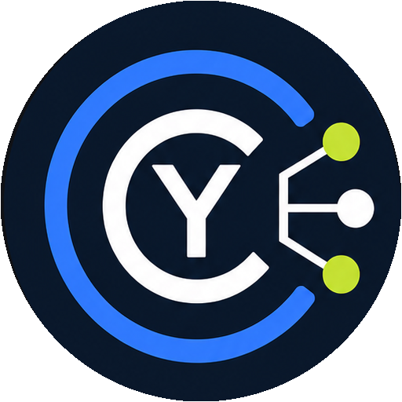
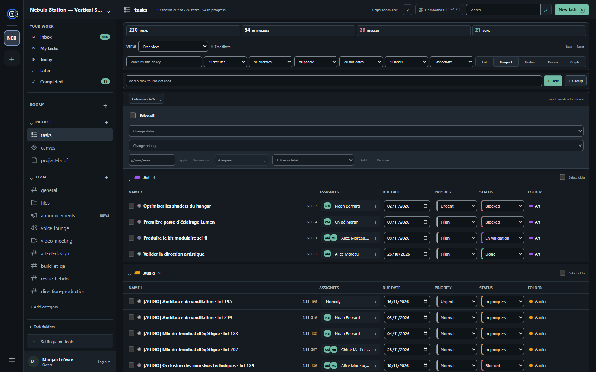
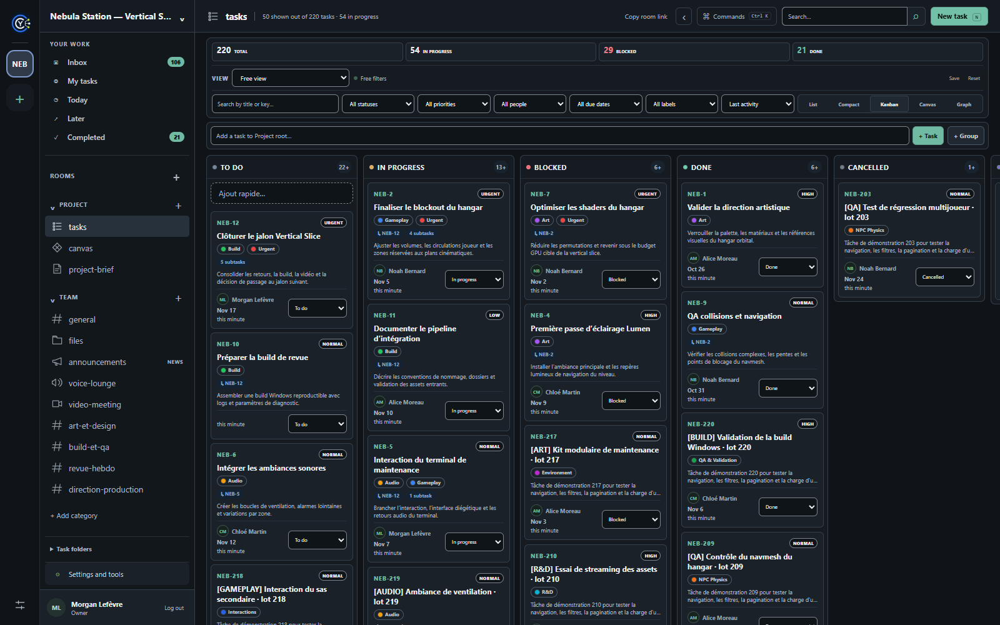
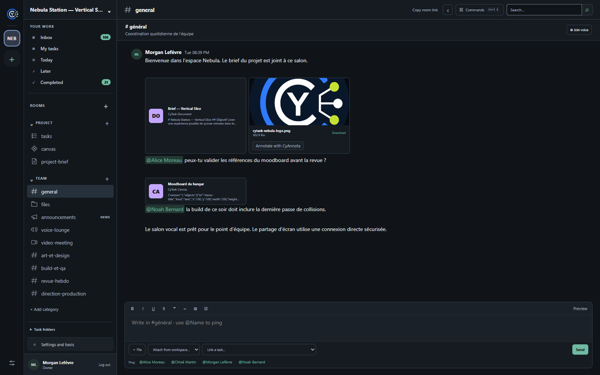
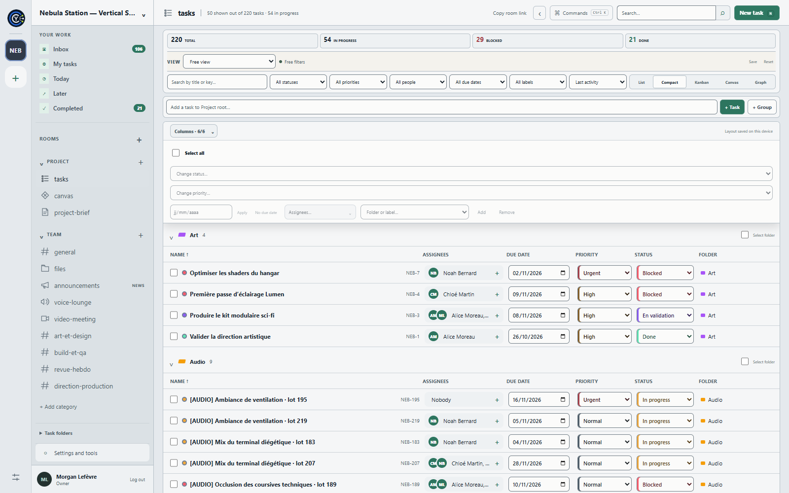

<table width="100%">
  <tr>
    <td width="300" align="left" valign="top">
      <a href="https://mrmybal.github.io/CyTask/Documentation.html#/en/getting-started">Documentation</a><br>
      <a href="https://github.com/MrMybal/CyTask">Source repository</a><br>
      <a href="https://github.com/MrMybal/CyTask/issues">Issue tracker</a><br><br>
      <sub>README</sub><br>
      <a href="README.md">English</a> · <a href="README.fr.md">Français</a>
    </td>
    <td width="400" align="center" valign="middle">
      <a href="assets/branding/cytask-logo.png"></a>
    </td>
    <td width="300" align="right" valign="top">
      <p><sub>Application license</sub><br><a href="LICENSE"><strong>GNU AGPL v3</strong></a></p>
      <p><sub>Version</sub><br><a href="CHANGELOG.md"><strong>0.2.3</strong></a><br><strong>IN DEVELOPMENT</strong></p>
      <p><a href="https://github.com/MrMybal/CyTask/releases/tag/v0.2.3"><strong>Download 0.2.3</strong></a><br><sub>Windows x64 · portable / installer</sub></p>
    </td>
  </tr>
</table>

<h1 align="center">CyTask</h1>

An open-source project and task manager for digital production teams, independent creators and Unreal Engine workflows. Use a local folder on your own, synchronize trusted devices, or connect to a self-hosted team server. A Git repository is optional.

> **IN DEVELOPMENT · 0.2.3**
>
> A Windows client is available for testing and feedback. Some integrations and platforms remain incomplete; keep restorable backups of important projects. Read the [version notes and documented limitations](CHANGELOG.md).

[](assets/screenshots/tasks-compact.png)

## About CyTask

Projects are workspaces with categories and typed rooms: task boards, team discussions, announcements, documents, canvases, files and live calls. Organize tasks in folders and subfolders, assign several people, define colored workflow states and track subtasks, checklists and dependencies. Choose List, Compact table, Kanban, Canvas or Graph according to the work.

The desktop client can open a local folder directly in solo mode, without an interactive account screen. Sync mode uses immutable snapshots and media files with an external transport such as Syncthing or CyRevision Sync; it does not replicate a live database. A team server uses PostgreSQL, invitations and project-specific permissions.

| Kanban board | Team discussion and shared media |
| --- | --- |
| [](assets/screenshots/kanban.png) | [](assets/screenshots/team-chat.png) |

These screenshots use the fictional **Nebula Station** demo project with 220 tasks. Project-authored text keeps its original language. The interface defaults to English and also supports French.

<details>
<summary>See the light appearance</summary>

[](assets/screenshots/tasks-light.png)

Six presets are available: Graphite, Midnight, Forest, Cloud, Paper and High contrast.

</details>

## Features

- **Tasks and hierarchy:** multiple assignees, custom states, priorities, dates, labels, parent/child tasks, dependencies, checklists and activity history.
- **Fast navigation:** per-column sorting, inline edits, saved filters, configurable columns, bulk updates, command palette and shareable task links.
- **Team rooms:** channels and private groups, mentions, task previews, image/video playback, voice, live cameras and independent screen sharing.
- **Shared resources:** documents, multimedia canvases, drawing, files and task attachments with image previews on Kanban cards.
- **Local or hosted:** standalone folders, externally synchronized workspaces, or a self-hosted server with optional two-factor authentication and encryption at rest.
- **Migration:** preview ClickUp or Jira Cloud imports, map users and states, then import supported task data without duplicating previous imports. Remote attachments remain source links.
- **Optional integrations:** Git, AI Assistant, Unreal Engine, CyRevision and CyAnnota; CyMD adds rich Markdown editing. Project plugins contribute validated fields and supported content actions, not arbitrary manifest-injected code.
- **Agents and automation:** scoped agent identities, durable work calls, notifications, atomic task claiming, a JavaScript SDK and an MCP stdio connector. A work call does not execute arbitrary task text.
- **Integrated help:** complete English/French CyDoc guides, API contracts, screenshots, SVG diagrams, search and reading themes. Desktop opens the bundled `Documentation/Documentation.html` directly; the same reader is [available online](https://mrmybal.github.io/CyTask/Documentation.html#/en/getting-started).

---

## Installation

### Windows x64

The published 0.2.3 client includes Electron, the local .NET engine, the Web interface and offline help. No separate Node.js, .NET SDK or database installation is needed for solo local use.

1. Download the [portable executable](https://github.com/MrMybal/CyTask/releases/download/v0.2.3/CyTask-0.2.3-portable-x64.exe) or [installer](https://github.com/MrMybal/CyTask/releases/download/v0.2.3/CyTask-0.2.3-setup-x64.exe).
2. Close an older CyTask instance, then launch the portable file or run the installer. Keep your existing project folders and back up encryption keys separately.
3. Choose **Local folder** to work on your own, **Sync** for an externally synchronized folder, or a server connection using its HTTPS address and your team account.
4. Create a project and your first task, or reopen an existing workspace.

[Release notes and SHA-256 checksums](https://github.com/MrMybal/CyTask/releases/tag/v0.2.3) accompany the downloads. These executables are not Authenticode-signed; Windows SmartScreen may display a warning.

### Team server and other platforms

Deploy your own server with persistent PostgreSQL/media storage and HTTPS; see the [administration manual](https://mrmybal.github.io/CyTask/Documentation.html#/en/administration) and [deployment configuration](infra/README.md). SMTP and STUN/TURN are configured separately when email codes or calls need them.

Linux and macOS packaging targets exist in the source, but release 0.2.3 supplies Windows x64 binaries only. There is no published Android client. See the [platform and integration limits](CHANGELOG.md#documented-limitations).

## Source, build and required libraries

<details>
<summary>Build the desktop client or run the development workspace</summary>

Use Node.js **22.17.1** and npm, the .NET SDK **10.0.302** from `global.json`, and PowerShell 7 for the Windows helper scripts. PostgreSQL is needed for a persistent team deployment, not the local-folder engine. Unreal is only needed when building its optional source plugin.

```sh
git clone https://github.com/MrMybal/CyTask.git
cd CyTask
npm ci --prefix apps/web
npm ci --prefix apps/client
npm ci --prefix plugins/cymd/web
npm ci --prefix plugins/cyannota/web
npm run dist:win --prefix apps/client
```

The desktop build compiles both bundled editors, the Web interface and documentation, publishes the self-contained server, then writes the portable and installer files to `apps/client/release/`. The build installs the pinned local CyDoc archive; access to CyDoc's private source repository is not required. Use a system `dotnet`, or install the SDK under `.tools/dotnet`.

For development, the Windows helper specifically expects `.tools/dotnet/dotnet.exe`:

```powershell
./scripts/dev.ps1
```

Open `http://127.0.0.1:5173`. This development server uses in-memory storage and loses its data after restart; it is not a persistent team deployment. With it running, use `pwsh ./scripts/seed-demo.ps1` in another terminal to create the fictional 220-task workspace. Demo credentials must not become production defaults.

See [desktop build details](apps/client/README.md), [documentation authoring](.CyDocBuild/README.md), [the SDK](packages/sdk-js/README.md) and [the MCP connector](integrations/mcp/README.md). Linux/macOS targets and the Unreal plugin require their own platform/engine builds; see [Unreal integration](integrations/unreal/README.md).

</details>

---

## License

CyTask's root [LICENSE](LICENSE) contains the **GNU Affero General Public License v3**. Third-party components keep their own terms; the MIT license of CyDoc or Electron does not change CyTask's license.

### Main runtime and optional components

| Library · source | License · terms | Use / scope |
| --- | --- | --- |
| [React / React DOM](https://github.com/facebook/react) | [MIT](https://github.com/facebook/react/blob/main/LICENSE) | Web application and bundled editor interfaces. |
| [CodeMirror](https://github.com/codemirror) / [Lezer](https://github.com/lezer-parser) | [MIT](https://github.com/codemirror/view/blob/main/LICENSE) | Markdown editing and syntax infrastructure. |
| [markdown-it](https://github.com/markdown-it/markdown-it) | [MIT](https://github.com/markdown-it/markdown-it/blob/master/LICENSE) | Markdown rendering in the application and CyMD. |
| [highlight.js](https://github.com/highlightjs/highlight.js) | [BSD-3-Clause](https://github.com/highlightjs/highlight.js/blob/main/LICENSE) | Code highlighting in messages and documents. |
| [DOMPurify](https://github.com/cure53/DOMPurify) | [Apache-2.0](https://github.com/cure53/DOMPurify/blob/main/LICENSE) OR [MPL-2.0](https://github.com/cure53/DOMPurify/blob/main/LICENSE-MPL) | Sanitizing rendered rich content; dual-license choice retained. |
| [node-qrcode](https://github.com/soldair/node-qrcode) | [MIT](https://github.com/soldair/node-qrcode/blob/master/license) | Local authenticator QR-code generation. |
| [Electron 44.9.3](https://github.com/electron/electron) | [MIT](https://github.com/electron/electron/blob/v44.9.3/LICENSE) and bundled component notices | Desktop runtime, including Chromium and Node.js components. |
| [.NET / ASP.NET Core 10](https://github.com/dotnet/runtime) | [.NET Library License](https://dotnet.microsoft.com/en-us/dotnet_library_license.htm) for Windows distributions; [MIT and component terms](https://github.com/dotnet/core/blob/main/license-information.md) for source/Linux/macOS | Server and self-contained desktop sidecar. |
| [Npgsql 10.0.3](https://github.com/npgsql/npgsql) / [PostgreSQL](https://www.postgresql.org/) | [PostgreSQL License](https://www.postgresql.org/about/licence/) | Npgsql is a server dependency; PostgreSQL is the separate persistent team database. |
| [MailKit / MimeKit 4.18.2](https://github.com/jstedfast/MailKit) | [MIT](https://github.com/jstedfast/MailKit/blob/master/LICENSE) | Server SMTP delivery when email authentication is configured. |
| [CyMD 0.1.4](plugins/cymd/README.md) | [AGPL-3.0-only](plugins/cymd/LICENSE) | Bundled optional Markdown editor; its distribution includes corresponding frontend sources. |
| [ffmpeg.wasm wrapper](https://github.com/ffmpegwasm/ffmpeg.wasm) | [MIT](https://github.com/ffmpegwasm/ffmpeg.wasm/blob/main/LICENSE) | `@ffmpeg/ffmpeg` in the CyAnnota integration. |
| [ffmpeg.wasm core 0.12.10](https://github.com/ffmpegwasm/ffmpeg.wasm) | [GPL-2.0-or-later and external-library terms](https://ffmpegwasm.netlify.app/docs/faq/#what-is-the-license-of-ffmpegwasm) | Bundled WASM media engine for CyAnnota, not automatic task-upload transcoding. |
| [JSZip](https://github.com/Stuk/jszip) / [fflate](https://github.com/101arrowz/fflate) | [MIT OR GPL-3.0-or-later](https://github.com/Stuk/jszip/blob/main/LICENSE.markdown) / [MIT](https://github.com/101arrowz/fflate/blob/master/LICENSE) | Archive handling in bundled editors. |
| [CyDoc 0.1.0](https://github.com/MrMybal/CyDoc) | [MIT](https://github.com/MrMybal/CyDoc/blob/6ddf9a582defb2f11fbb3f992afef6f98dcadc93/LICENSE) | Packaged documentation reader; image/gallery modules only. Source access may require permission. |

### Build and development

| Library · source | License · terms | Use / scope |
| --- | --- | --- |
| [Node.js](https://github.com/nodejs/node) | [MIT and component notices](https://github.com/nodejs/node/blob/v22.17.1/LICENSE) | Build scripts; also part of the Electron runtime. |
| [TypeScript](https://github.com/microsoft/TypeScript) | [Apache-2.0](https://github.com/microsoft/TypeScript/blob/main/LICENSE.txt) | Type checking and compilation. |
| [Vite](https://github.com/vitejs/vite) / [esbuild](https://github.com/evanw/esbuild) | [MIT](https://github.com/vitejs/vite/blob/main/LICENSE) / [MIT](https://github.com/evanw/esbuild/blob/main/LICENSE.md) | Web/editor builds and documentation bundling. |
| [marked](https://github.com/markedjs/marked) / [PrismJS](https://github.com/PrismJS/prism) | [MIT](https://github.com/markedjs/marked/blob/master/LICENSE) / [MIT](https://github.com/PrismJS/prism/blob/master/LICENSE) | Documentation generation; not a task-application runtime requirement. |
| [electron-builder](https://github.com/electron-userland/electron-builder) | [MIT](https://github.com/electron-userland/electron-builder/blob/master/LICENSE) | Desktop installer and portable packaging. |
| [Playwright](https://github.com/microsoft/playwright) | [Apache-2.0](https://github.com/microsoft/playwright/blob/main/LICENSE) | Development/test browser automation, not bundled with the application. |

This is an index of the main components, not a complete transitive inventory. Retain the component licenses, browser credits and corresponding-source material supplied with each distribution. Unreal Engine has its own [Epic license terms](https://www.unrealengine.com/en-US/eula/unreal); it is an optional editor host, not a bundled open-source runtime.

## References and links

- [English manual](https://mrmybal.github.io/CyTask/Documentation.html#/en/getting-started) · [Manuel en français](https://mrmybal.github.io/CyTask/Documentation.html#/fr/getting-started).
- [Version notes and limitations](CHANGELOG.md) · [Published releases](https://github.com/MrMybal/CyTask/releases).
- [Source repository](https://github.com/MrMybal/CyTask) · [Issue tracker](https://github.com/MrMybal/CyTask/issues).
- [Local/Sync guide](https://mrmybal.github.io/CyTask/Documentation.html#/en/desktop-local) · [Server administration](https://mrmybal.github.io/CyTask/Documentation.html#/en/administration).
- [Plugin contracts](packages/contracts) · [Unreal connector](integrations/unreal/README.md) · [Content extension protocol](docs/content-plugins.md).
- [Product roadmap](docs/04-feuille-de-route.md) and [architecture decisions](docs/decisions) describe design work, not a list of features guaranteed in every released client.
